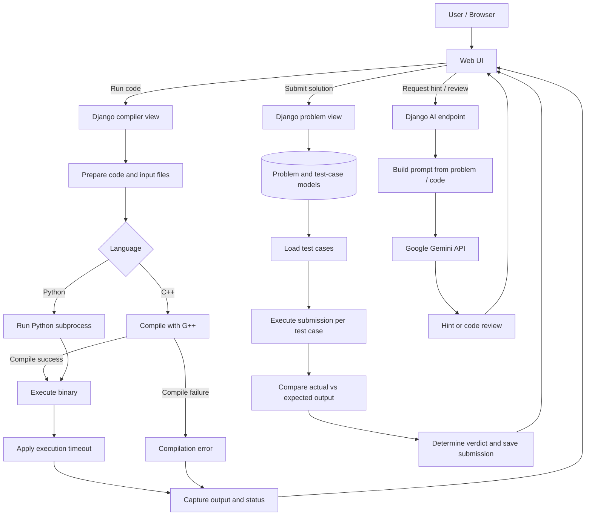

# ⚡ Online Judge — AI-Powered Coding Platform

<p align="center">
  <strong>Practice DSA. Run code. Learn with AI.</strong><br/>
  A web-based coding platform with test-case evaluation and Gemini-powered hints and code reviews.
</p>

<p align="center">
  
  
  
  
  
  
</p>

---

## 📌 Overview

**Online Judge** is a coding-practice platform built to bring problem solving, code execution, test-case evaluation, and AI-assisted learning into one place. Users can work on programming problems, run Python or C++ code, compare output against test cases, and request hints or code feedback from Google Gemini.

The project combines a Django backend, a web UI, subprocess-based code execution, and an external generative-AI API.

## ✨ Features

- **Problem practice** — problem statements, input/output specifications, constraints, and difficulty.
- **Code execution** — execute Python submissions and compile/run C++ submissions.
- **Test-case evaluation** — compare actual output with expected output and produce a verdict.
- **Execution timeout** — stop executions that exceed the configured time limit.
- **AI-generated hints** — request guidance intended to help users reason through a problem rather than immediately show the full solution.
- **AI code review** — receive suggestions about logic, edge cases, time complexity, space complexity, and potential improvements.
- **User authentication** — register, log in, and manage a session.
- **Responsive interface** — a coding experience designed to adapt to different screen sizes.
- **Containerized deployment** — Docker packages the Django runtime and dependencies for deployment.
- **AWS deployment** — deployment target for hosting the application on EC2.

## 🧰 Technology Stack

| Layer | Technology | Role |
|---|---|---|
| Backend | Python, Django | Routes, authentication, problem and submission logic |
| Code execution | Python subprocess, G++ | Execute Python and compile/execute C++ |
| Data layer | Django ORM, SQLite in the current backend configuration | Store problems, test cases, and submissions |
| AI assistance | Google Gemini API | Generate hints and analyze submitted code |
| Frontend | Django templates / UI assets; React frontend source is maintained separately | User-facing interface |
| Styling | CSS / Tailwind CSS in the frontend project | Responsive styling |
| Containerization | Docker | Package application environment and dependencies |
| Deployment | AWS EC2 | Host the application |

> **Architecture note:** The current code runner uses host-level subprocess execution. Docker currently packages the application environment; it does **not** automatically create an isolated Docker container for every user submission. Do not treat the current runner as a production-grade sandbox for untrusted code.

## 🏗️ Architecture



### How evaluation works

1. The user selects a problem and provides code.
2. Django prepares the submission and input data.
3. Python code is executed with the Python interpreter; C++ code is compiled with G++ and then executed.
4. Execution output, errors, and elapsed time are collected.
5. During judging, the output is compared with the expected output for each stored test case.
6. Django returns the verdict and records the submission.

AI feedback is **advisory**. The program's verdict is based on execution and test-case comparison, not on Gemini's opinion.

## 🗂️ Data Model (high level)

- **Problem** — title, statement, input/output format, constraints, and difficulty.
- **TestCase** — input data, expected output, sample-test marker, and related problem.
- **CodeSubmission** — language, source code, input/output, and submission timestamp.
- **User** — authentication and session management.

## 🚀 Getting Started

> These instructions are a general Django setup guide. Confirm paths and package names against the checked-out source before running commands.

### Prerequisites

- Python 3.11+
- Git
- G++ / GCC for C++ compilation
- A Google Gemini API key for AI features
- Docker (optional, for containerized execution)

### 1. Clone the repository

```bash
git clone https://github.com/ish4722/Online-Judge.git
cd Online-Judge
```

### 2. Create and activate a virtual environment

**macOS / Linux**
```bash
python3 -m venv .venv
source .venv/bin/activate
```

**Windows PowerShell**
```powershell
py -m venv .venv
.venv\Scripts\Activate.ps1
```

### 3. Install dependencies

From the directory containing the backend's requirements file:

```bash
pip install -r requirements.txt
```

If the requirements file is nested, change into that backend directory first.

### 4. Configure environment variables

Create a local `.env` file in the backend directory if the project configuration expects one:

```env
GEMINI_API_KEY=replace_with_your_key
```

Never commit real API keys. If a key has been exposed in code, logs, a container image, or a public commit, rotate it.

### 5. Apply migrations and run Django

From the directory containing `manage.py`:

```bash
python manage.py migrate
python manage.py runserver
```

Open the local address printed by Django in your terminal (typically `http://127.0.0.1:8000/`).

### Run with Docker

From the directory containing the Dockerfile:

```bash
docker build -t online-judge:dev .
docker run --rm --name online-judge -p 8000:8000 --env-file .env online-judge:dev
```

The image's startup command and environment configuration must match the Dockerfile in the repository. Do not bake `.env` into the image; exclude it using `.dockerignore` and supply secrets at runtime.

## 🔐 Security Considerations

This is an educational online judge, and running arbitrary code requires careful isolation. The current subprocess-based execution and timeout should not be considered sufficient protection for a public, multi-user judge.

Before exposing code execution to untrusted users, add or adopt a dedicated execution sandbox with appropriate controls, including:

- Per-submission isolation and non-root execution
- CPU, memory, process-count, and wall-clock limits
- Restricted filesystem access and network access
- Controlled temporary directories and output-size limits
- Reliable process-tree termination and cleanup
- Rate limits and authentication/authorization checks
- Secret management and safe logging
- Production-grade application server and deployment configuration

Keep the Gemini API key on the server. Never expose it in frontend JavaScript or return it to the browser.

## 🛣️ Potential Improvements

- Use an isolated execution worker or purpose-built judge sandbox.
- Add PostgreSQL for production workloads requiring stronger concurrent-write support.
- Introduce a job queue for long-running submissions.
- Add automated tests for compilation errors, timeouts, incorrect answers, and edge cases.
- Add structured logs, metrics, health checks, and request-rate limits.
- Cache repeatable AI hints where appropriate.
- Use a production WSGI server, secure secret management, and reproducible image tags.
- Document the React/Django integration and provide verified screenshots or a live demo.

## 🧪 Testing Checklist

- [ ] Python program with correct output
- [ ] C++ program that compiles and runs
- [ ] Compilation error
- [ ] Wrong answer
- [ ] Execution timeout
- [ ] Empty input and edge cases
- [ ] AI hint request succeeds and handles API errors
- [ ] AI code review handles missing/invalid input
- [ ] Authentication and protected routes
- [ ] Container starts with the required environment variables

## 📁 Source Repositories

The project components originated in these repositories:

- [Django backend — Online_Judge_Project_Django](https://github.com/Medix1075/Online_Judge_Project_Django)
- [React frontend — Online_Judge_Project_React](https://github.com/Medix1075/Online_Judge_Project_React)

The intended consolidated repository is [ish4722/Online-Judge](https://github.com/ish4722/Online-Judge).

## 👤 Maintainer

**ish4722**

- GitHub: [@ish4722](https://github.com/ish4722)

---

<p align="center">
  <strong>Built to make coding practice more interactive, testable, and accessible.</strong>
</p>
